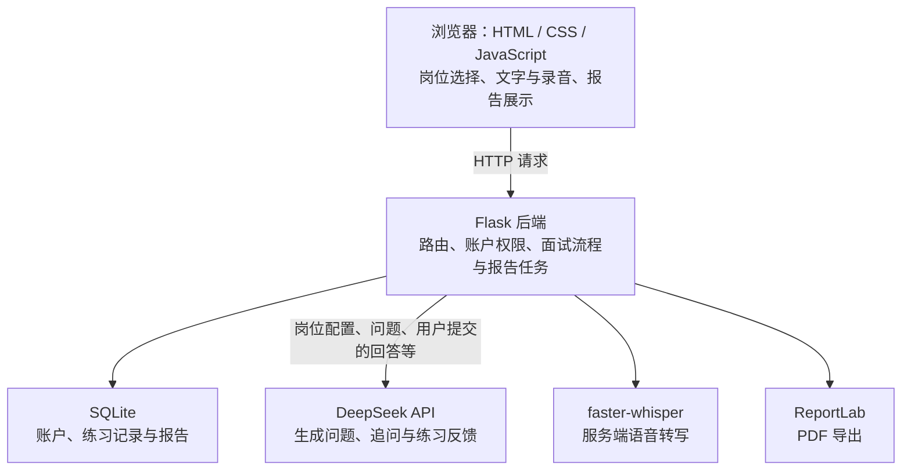

# AI Interview Agent

面向求职练习的 AI 模拟面试网站，使用 Flask、DeepSeek 和 SQLite，支持文字回答、语音转写和面试复盘。

## 比赛最终版

发布分支：`competition-final-20261103`。包含阶段二工程优化及最终UI收尾，保持现有技术架构、评分与PDF功能。验收基线为38个测试脚本、201项单元测试。

## 当前功能

- 用户名密码注册登录、个人资料、修改密码、撤销其他设备登录、注销账户。
- 游客试用保留；确认后迁移本浏览器记录，账户跨设备查看。
- 账户专业和学习阶段默认不发送给AI；本场开始前独立选择。
- 报告中的重答练习可保存并对照原回答，不调用AI、不重新评分。


- 按学科和专业逐级选择练习方向，保留直接选择岗位的入口。
- 提供多种面试难度，根据回答进行追问。
- 每题给出具体点评、回答思路、参考回答与练习建议。
- 回答草稿按面试和题目保存在当前浏览器，24小时内可恢复；过期项在读取或初始化时清理。
- 首页和历史记录可继续未完成面试，手机提供可展开的导航菜单。
- 报告后台生成，等待时先看已保存的逐题点评；可离开后回来查看，失败后手动重试。
- 静态资源按内容生成版本，重复访问可使用浏览器缓存。
- 最后一题提交后保留题目、回答和点评，收起作答控件，由用户手动生成或查看报告。
- 综合评分、八维分析、薄弱点建议、历史记录和 PDF 导出。
- 可选填写练习背景，并提供语音分析功能。

## 技术架构



这是逻辑架构图。浏览器录音上传至服务器临时处理，本机模型转写后返回文字；用户检查、编辑并提交的回答用于面试与评价。报告由后台任务生成，PDF 由 ReportLab 导出。草稿保存在浏览器；游客和账户练习记录保存在服务端 SQLite。生产部署使用 Waitress 单进程多线程，由 Nginx 反向代理；进程内状态使多进程部署需要额外设计，详见 [部署手册](deploy/README.md)。

## 代码结构

- `app.py`：Flask 路由、面试处理及模型调用。
- `accounts.py`、`account_migration.py`：账户、权限与数据库迁移。
- `database.py`：SQLite 数据表及读写。
- `speech.py`、`audio_analysis.py`：语音转写与可选音频分析。
- `practice_feedback.py`、`report_jobs.py`、`report_pdf.py`：评价、报告任务和 PDF。
- `static/`、根目录 HTML：浏览器界面；`tests/`：测试；`deploy/`：部署配置。

## 本地运行（Windows）

以下命令面向 Windows PowerShell。先安装 Git 与 Python 3.13，并确认版本：

```powershell
git --version
python --version
git clone --branch competition-final-20261103 https://github.com/jackhe68/AI-Interview-Agent.git
cd AI-Interview-Agent
```

在项目目录执行：

```powershell
python -m venv .venv
.\.venv\Scripts\python.exe -m pip install -r deploy\requirements.txt
Copy-Item .env.example .env
```

在本地 `.env` 中填写 `DEEPSEEK_API_KEY`，然后启动：

```powershell
$env:APP_INSECURE = "1"  # 仅本机HTTP调试
.\.venv\Scripts\python.exe app.py
```

浏览器打开 <http://127.0.0.1:5001>。可在另一个 PowerShell 窗口访问 <http://127.0.0.1:5001/api/health>：`ok` 表示应用响应，`deepseek_configured` 表示客户端已配置。

首次使用语音转写需要下载 Whisper 模型，下载需要网络和磁盘空间；纯文字练习不需要先下载模型。`APP_INSECURE=1` 仅用于本机 HTTP 调试，不用于 HTTPS 生产部署。

若启动失败，先确认 Python 版本、依赖安装完成及 5001 端口未被占用；若 AI 请求失败，检查 `.env` 中的 `DEEPSEEK_API_KEY`、账户额度和网络，不要公开或提交密钥。模型服务故障不代表本地页面无法打开。生产运行及排障见 [部署手册](deploy/README.md)。

## 测试

在项目目录并使用上述虚拟环境，可先运行不需要真实 API 密钥的语音接口基础检查：

```powershell
.\.venv\Scripts\python.exe -m unittest discover -s tests -p test_speech42.py
```

此文件使用临时 SQLite、测试客户端和模拟的转写；运行时依赖见 `deploy/requirements.txt`。浏览器测试还需安装相应浏览器和 Playwright 等开发依赖，部分语音集成检查需要模型；具体条件见对应测试及验收文档。

## 数据与隐私边界

- 游客练习保存在服务端，通过浏览器凭据关联；登录后需要用户确认才能迁移至账户。
- 未提交的文字草稿保存在当前浏览器，超过 24 小时在读取或初始化时检查并清理，并非定时准点删除。
- 录音上传到服务器，产生临时文件供转写，处理结束时尝试清理；转写文字经用户提交后作为回答保存，并发送给 DeepSeek 生成反馈。
- 练习回答可能含有用户自行填写的个人信息。账户资料默认不自动作为本场背景发送，授权选项及删除说明见应用中的隐私页面。第三方收到的数据按其自身处理规则处理。

## 团队信息

- 团队名称：山缺一
- 学校：重庆外语外事学院
- 成员及分工：李嘉豪、张文佳、何佳骏
- 指导教师：谢从晋


## 文档

- [比赛最终版UI、完成状态与验收记录](docs/final-ui-verification.md)
- [逐点优化、测试与回滚记录](docs/stepwise-optimization.md)
- [开始请求回执与恢复](docs/start-request-recovery.md)
- [评分依据与有效作答覆盖](docs/scoring-evidence.md)
- [AI服务异常与有限重试](docs/ai-service-errors.md)

- [开始面试与公网启动故障恢复](docs/startup-recovery.md)

- [账户、安全、数据库迁移与运维交付](docs/accounts-and-operations.md)

- [公网试用说明](docs/public-trial-guide.md)
- [正式部署说明](deploy/README.md)
- [新评估报告复核与改进](docs/new-assessment-review.md)
- [时间与基础交互优化](docs/time-and-interaction.md)
- [继续面试与后台报告](docs/practice-flow.md)
- [草稿保护与手动查看报告](docs/draft-recovery.md)
- [专业选择与岗位推荐](docs/major-paths.md)
- [后续改进待办](docs/improvement-backlog.md)

`tests/` 包含面试流程、草稿恢复、语音、报告与浏览器交互检查；部分检查需要本机浏览器和语音模型，浏览器路径可在对应脚本中调整。

## 本地配置与数据

仓库保留代码、测试和说明文档，排除 `.env`、密钥、面试数据库、用户录音、运行日志、虚拟环境和下载模型。`tests/chinese-fixture.wav` 是语音测试使用的合成音频。PDF 中文字体及其许可位于 `assets/fonts/`。
